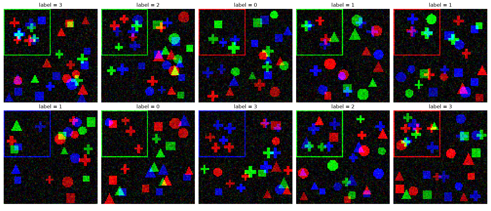

# Лабораторна 2. Згорткові нейронні мережі

## Завдання

Вам дано датасет, що складається із зображень і числової мітки для кожного зображення. Ваше завдання: побудувати і натренувати в PyTorch модель, що класифікує ці зображення і генералізує на тестову вибірку, з якомога меншою кількістю параметрів.

**Дані:** [lab2_data](https://drive.google.com/drive/folders/1evJQoC_OHT9Q8e5JEdouonYamYyJ3BHB?usp=drive_link)

**Формат даних:** файли `train.npz` (20 000 зображень) і `test.npz` (5 000 зображень). Кожен містить:

- `X`: масив `uint8` розміру `N x 3 x 96 x 96`, кольорові зображення (канали RGB);
- `y`: мітки класів `0, 1, 2, 3`.

```python
import numpy as np

d = np.load("train.npz")
X_train = d["X"].astype(np.float32) / 255
y_train = d["y"]
```



## Правила і оцінювання

Щоб отримати бали за лабораторну, натренована модель має мати точність **не менше 90%** на тестовій вибірці. Бали визначаються найменшою за кількістю параметрів моделлю що досягнула поріг точності.

| Бали | Кількість параметрів (при точності на `test` не менше 90%) |
|---|---|
| 12 | будь-яка |
| 13 | не більше 5 000 |
| 15 | не більше 1 000 |
| 16 | не більше 400 |
| +4 | захист: пояснення виборів архітектури моделі |

**Формат здачі:** один `ipynb` файл, виконаний від початку до кінця, або посилання на Google Colab. Для фінальної моделі має бути підрахована кількість параметрів і точність на тестовій вибірці. 
**Підрахунок параметрів.** Кількість параметрів рахується наступним чином

```python
def count_params(model):
    return sum(p.numel() for p in model.parameters())
```

- Моделлю вважається вся обробка від сирого `X` до передбачення.
- Операції без ваг дозволені і не впливають на кількість параметрів.
- Числа, які працюють як ваги, рахуються, навіть якщо вони не навчаються. Наприклад, фіксоване ядро згортки, записане як буфер, додається до кількості параметрів.
- Буфери `BatchNorm` (`running_mean`, `running_var`) не рахуються.

**Підрахунок точності.** Точність це частка зображень з `test`, для яких передбачений клас збігається з міткою, модель оцінюється в режимі `model.eval()`

**Тренування і тест.** Модель тренується тільки на `train`. Для вибору архітектури та гіперпараметрів можете виділити валідаційну частину з `train`, `test` використовується тільки для оцінки точності. Зафіксуйте `seed` для відтворюваності результатів.

**Поради по виконанню.** 
- Для тренування на прискорювачах можна використовувати безкоштовні версії Google Colab або Kaggle. 
- Рекомендується вести журнал експериментів: короткий опис модель - к-ть параметрів - результат на тесті - особливості архітектури / що було спробувано.
